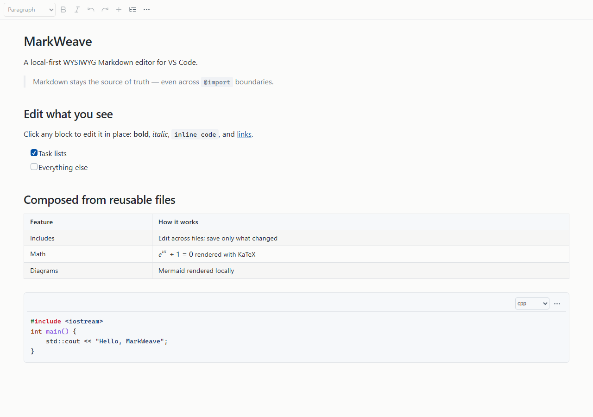

<p align="center"></p>

<h1 align="center">MarkWeave</h1>

<p align="center"><strong>Un éditeur Markdown local-first pour VS Code.</strong><br>
Cliquez sur n'importe quel bloc pour le modifier sur place, et gardez vos fichiers <code>.md</code> comme source unique de vérité.</p>

<p align="center">
  <a href="README.md">English</a> ·
  <a href="README.zh-CN.md">简体中文</a> ·
  <a href="README.ja.md">日本語</a> ·
  <a href="README.ko.md">한국어</a> ·
  <a href="README.es.md">Español</a> ·
  <strong>Français</strong> ·
  <a href="README.de.md">Deutsch</a> ·
  <a href="README.ru.md">Русский</a>
</p>

<p align="center">
  <a href="https://github.com/singerawei/markweave/releases"></a>
  
  
  
</p>

<p align="center"></p>

MarkWeave transforme des fichiers `.md` ordinaires en un document modifiable au clic dans VS Code. Vos fichiers restent la source unique de vérité : chaque enregistrement réécrit le Markdown dans le fichier qui possède le contenu, de sorte que Git, votre éditeur de texte et tous les autres outils Markdown continuent de fonctionner.

Il est conçu pour les documents qui grandissent. Composez un document continu à partir de plusieurs fichiers avec `@import`, modifiez chaque section incluse sur place et n'enregistrez que les fichiers qui ont réellement changé. Aucun compte, aucune base de données, aucune télémétrie et aucun navigateur requis.

> **Aperçu :** la version 2.1.0 est un aperçu pour Windows x64. Installez-la depuis [GitHub Releases](https://github.com/singerawei/markweave/releases).

## Ce qui le distingue

- **Markdown en entrée, Markdown en sortie.** Pas de format propriétaire ni de base de données cachée. Le document rendu et le fichier source restent synchronisés.
- **Des includes modifiables.** Importez de nombreux fichiers dans une seule vue ; les modifications retournent dans le bon fichier source, y compris pour les imports imbriqués ou répétés.
- **Rendu, jamais remplacé.** Les blocs complexes restent rendus pendant leur modification ; ils ne se transforment jamais en zones de texte brut.
- **Local-first.** Aucune télémétrie, aucune connexion. Le seul trafic réseau provient des images distantes de votre document.
- **Confortable à grande échelle.** Les documents volumineux sont chargés progressivement et rendus près de la zone visible, avec un repli vers l'éditeur natif pour les blocs trop grands.

## Fonctionnalités

- **Modification au clic** — cliquez sur un paragraphe, un titre, une liste, un tableau, une liste de tâches, une citation, un bloc de code ou un lien pour le modifier sur place.
- **Markdown riche** — tableaux GFM, listes de tâches, mathématiques, notes de bas de page, alertes et callouts, admonitions, listes de définitions, TOC, liens wiki, surlignage, indice/exposant, emoji, frontmatter et un sous-ensemble HTML sûr.
- **Navigation** — Find et Outline partagent un panneau, suivent votre défilement et peuvent être épinglés par document.
- **Diagrammes Mermaid** — rendus et mis en cache localement ; copiez, modifiez, zoomez ou exportez en SVG/PNG.
- **Export PDF** — choisissez le format de papier, les marges, la taille de police, les en-têtes, les pieds de page, les numéros de page et les sauts de page H1. Les modifications non enregistrées sont incluses.
- **Lecture adaptée au thème** — suit les thèmes clair, sombre et à fort contraste de VS Code.
- **Pensé pour le clavier** — chaque action courante est une commande VS Code et peut être réassignée.
- **Documents longs** — le chargement progressif, le rendu à proximité de la zone visible et le déchargement du contenu lointain gardent les gros fichiers réactifs.

## Installation

**Prérequis :** Windows x64 et VS Code 1.100 ou supérieur. Aucune installation séparée de Chrome ou Edge n'est nécessaire.

1. Téléchargez `markweave-win32-x64-2.1.0.vsix` depuis [GitHub Releases](https://github.com/singerawei/markweave/releases).
2. Dans VS Code, ouvrez **Extensions**, cliquez sur **… → Installer depuis un VSIX…** et sélectionnez le fichier.
3. Rechargez VS Code.
4. Faites un clic droit sur un fichier `.md` et choisissez **Ouvrir avec… → Modular Markdown Editor**.

Le VSIX fait environ 125 Mo car il embarque le moteur Chromium utilisé pour le rendu Mermaid et l'export PDF.

<details>
<summary>Compiler depuis les sources</summary>

```sh
git clone https://github.com/singerawei/markweave.git
cd markweave
npm ci
npx playwright install chromium-headless-shell
npm run package
```

Nécessite Node.js 20.19+ (22 recommandé). Le VSIX généré est prêt à être installé.
</details>

## Démarrage rapide

1. **Ouvrez** un fichier `.md` avec **Ouvrir avec… → Modular Markdown Editor**.
2. **Modifiez** en cliquant sur n'importe quel bloc. Appuyez sur `Ctrl/Cmd+S` pour enregistrer ou `Ctrl/Cmd+Shift+S` pour enregistrer sous.
3. **Composez** plusieurs fichiers en une seule vue :

   ```markdown
   # Conception du système

   @import "./product/overview.md"
   @import "./architecture/system.md"
   @import "./features/payment.md"
   ```

   Modifiez directement les sections rendues ; l'enregistrement n'écrit que les fichiers source modifiés.
4. **Naviguez** avec `Ctrl/Cmd+Shift+O`, insérez des blocs avec `Ctrl/Cmd+Alt+I` et exportez avec **More → Export PDF**.

## Prise en charge de Markdown

| Syntaxe | Modification |
| --- | --- |
| Titres, paragraphes, emphase, code, citations, listes et séparateurs CommonMark | ✅ Sur place |
| Tableaux GFM, alignement, listes de tâches, barré et liens automatiques | ✅ Sur place |
| Surlignage `==texte==`, indice, exposant et emoji | ✅ Sur place |
| HTML sûr (`kbd`, `mark`, `details`, `sub`, `sup`, …) | ✅ Contenteditable rendu et assaini |
| Mathématiques `$...$`, `$$...$$` | ✅ KaTeX, éditeur de bloc avec aperçu en direct |
| Notes de bas de page, liens de référence, listes de définitions et abréviations | ✅ Rendu, éditeur de bloc avec aperçu en direct |
| GitHub Alerts, Obsidian Callouts et admonitions | ✅ Rendu, titres personnalisés et repliables |
| TOC, liens wiki, commentaires Obsidian et frontmatter | ✅ Rendu |
| Mermaid | ✅ Rendu localement |
| Images distantes | ✅ Chargées à l'ouverture ; téléchargées pour le PDF |

La syntaxe non prise en charge est conservée plutôt qu'aplatie.

## Raccourcis clavier

| Action | Windows / Linux | macOS |
| --- | --- | --- |
| Enregistrer / Enregistrer sous | `Ctrl+S` / `Ctrl+Shift+S` | `Cmd+S` / `Cmd+Shift+S` |
| Rechercher | `Ctrl+F` | `Cmd+F` |
| Plan / Naviguer | `Ctrl+Shift+O` | `Cmd+Shift+O` |
| Insérer | `Ctrl+Alt+I` | `Cmd+Alt+I` |
| Mode concentration | `Ctrl+Alt+F` | `Cmd+Alt+F` |
| Masquer la barre d'outils | `Ctrl+Alt+T` | `Cmd+Alt+T` |
| Aide | `?` ou `Ctrl+Alt+H` | `?` ou `Cmd+Alt+H` |

Tous les raccourcis sont des commandes VS Code et peuvent être réassignés. Consultez [docs/KEYBINDINGS.md](docs/KEYBINDINGS.md) pour la liste complète et les conflits avec l'hôte.

## Bon à savoir

- Fichiers `.md` locaux uniquement. Les systèmes de fichiers distants ou virtuels, la synchronisation cloud et les comptes ne sont pas pris en charge.
- **Enregistrer sous** doit rester dans le même dossier pour que les includes relatifs continuent de fonctionner.
- Les blocs trop volumineux reviennent à l'éditeur de texte : code de plus de 128 Kio, texte de plus de 16 Kio ou tableaux de plus de 200 lignes.
- Les inclusions wiki (`![[Page]]`) s'ouvrent sous forme de cartes cliquables, et non de transclusions complètes.
- L'aperçu 2.1.0 est destiné à Windows x64. Le seuil de publication stable recueille encore des preuves réelles d'utilisation, d'IME, de défilement long et d'installation.

## Développement

```sh
npm ci
npm run check        # lint, vérification des types, tests core et build
npx playwright install chromium
npm run test:ui      # tests d'interface
npm run test:host    # tests sur un hôte VS Code réel
npm run package      # construit le VSIX
```

Consultez [CONTRIBUTING.md](CONTRIBUTING.md) pour le processus de contribution.

## Licence

MIT. Les licences des dépendances tierces et de Chromium sont répertoriées dans [THIRD_PARTY_NOTICES.md](THIRD_PARTY_NOTICES.md).
