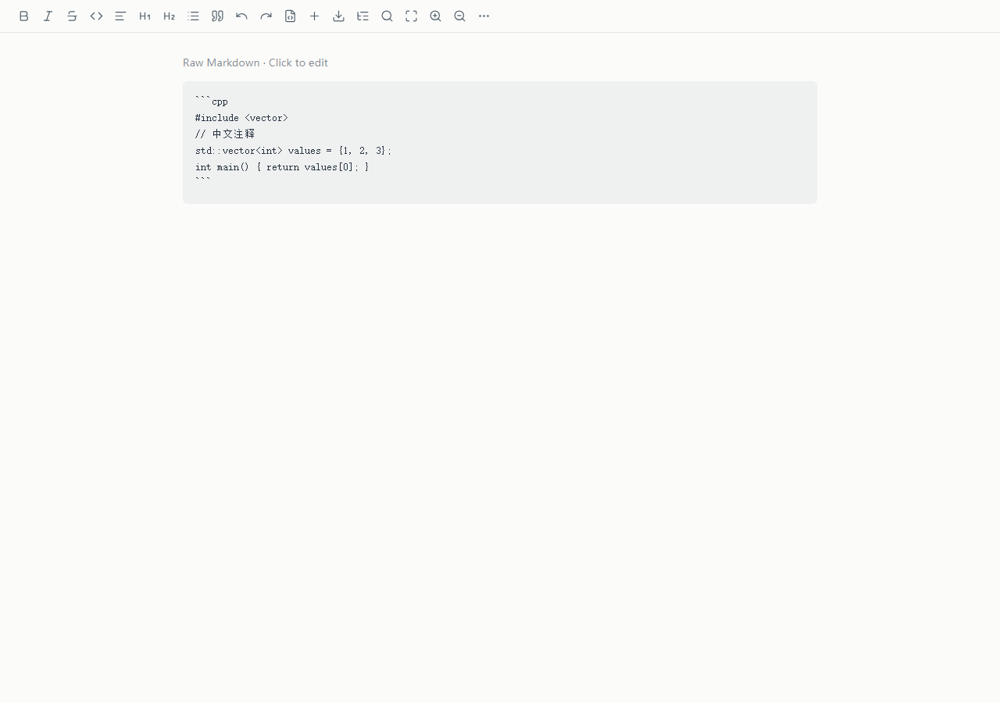
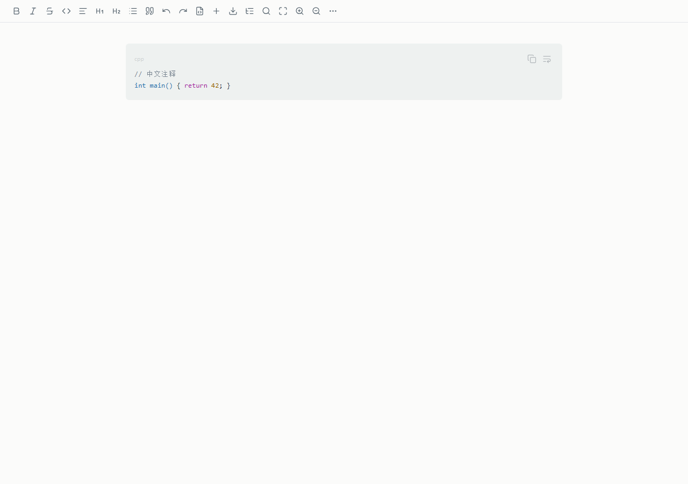
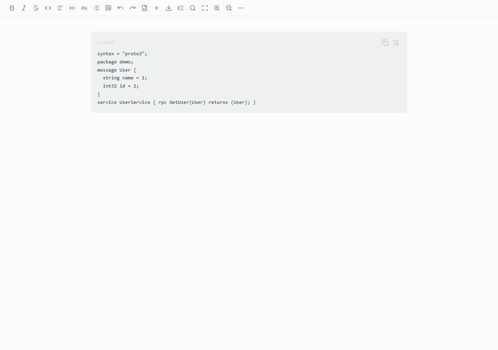
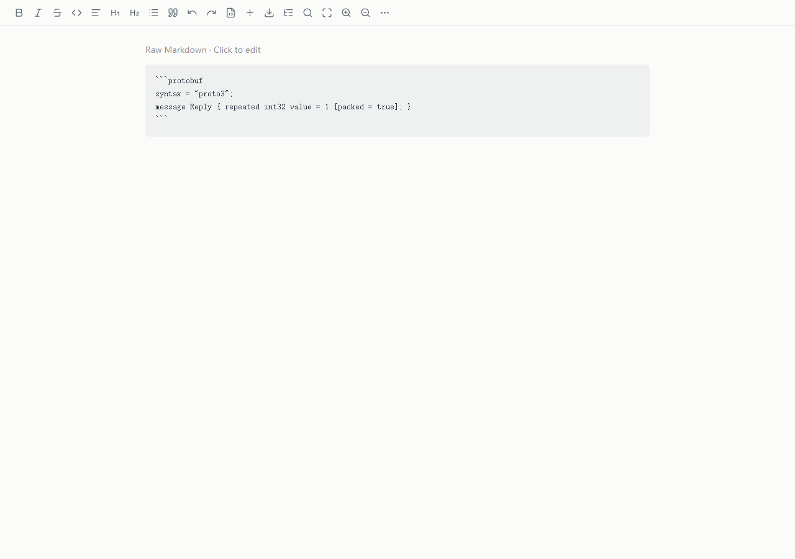

# 代码块：26 个真实样例的显示、编辑与保存

测试生产 Webview 与生产 SourceRepository，并在真实 VS Code 中额外打开 C++ / Protobuf。26 个样例中：**10 个样例正常高亮、5 个显示为普通代码文本、11 个被误判为原文保护块。** 这不是对 26 门语言的支持率；同一语言的不同内容可能走不同路径。

## 逐例结果

| 样例 | 围栏语言 | 实际显示 | 高亮 token 数 | 复制/换行工具 | 追加一个空格再保存，原代码仍保留 |
| --- | --- | --- | --- | --- | --- |
| cpp-standard | cpp | 原文块，连 Markdown 围栏一起显示 | 0 | 均无 | 是 |
| cpp-simple | cpp | 正常代码块 + 高亮 | 7 | Copy / Wrap lines | 是 |
| c | c | 原文块，连 Markdown 围栏一起显示 | 0 | 均无 | 是 |
| protobuf | protobuf | 正常代码块，纯文本，无高亮 | 0 | Copy / Wrap lines | 是 |
| proto | proto | 正常代码块，纯文本，无高亮 | 0 | Copy / Wrap lines | 是 |
| protobuf-options | protobuf | 原文块，连 Markdown 围栏一起显示 | 0 | 均无 | 是 |
| typescript | typescript | 正常代码块 + 高亮 | 9 | Copy / Wrap lines | 是 |
| typescript-generics | ts | 原文块，连 Markdown 围栏一起显示 | 0 | 均无 | 是 |
| javascript-array | javascript | 原文块，连 Markdown 围栏一起显示 | 0 | 均无 | 是 |
| python | python | 正常代码块 + 高亮 | 7 | Copy / Wrap lines | 是 |
| python-array | python | 原文块，连 Markdown 围栏一起显示 | 0 | 均无 | 是 |
| json | json | 正常代码块 + 高亮 | 10 | Copy / Wrap lines | 是 |
| json-array | json | 原文块，连 Markdown 围栏一起显示 | 0 | 均无 | 是 |
| yaml | yaml | 正常代码块 + 高亮 | 9 | Copy / Wrap lines | 是 |
| bash | bash | 正常代码块 + 高亮 | 9 | Copy / Wrap lines | 是 |
| sql | sql | 正常代码块 + 高亮 | 5 | Copy / Wrap lines | 是 |
| rust | rust | 原文块，连 Markdown 围栏一起显示 | 0 | 均无 | 是 |
| java | java | 正常代码块 + 高亮 | 9 | Copy / Wrap lines | 是 |
| csharp | csharp | 原文块，连 Markdown 围栏一起显示 | 0 | 均无 | 是 |
| go | go | 正常代码块 + 高亮 | 7 | Copy / Wrap lines | 是 |
| xml | xml | 原文块，连 Markdown 围栏一起显示 | 0 | 均无 | 是 |
| html | html | 原文块，连 Markdown 围栏一起显示 | 0 | 均无 | 是 |
| css | css | 正常代码块 + 高亮 | 4 | Copy / Wrap lines | 是 |
| cmake | cmake | 正常代码块，纯文本，无高亮 | 0 | Copy / Wrap lines | 是 |
| unknown | madeup-language | 正常代码块，纯文本，无高亮 | 0 | Copy / Wrap lines | 是 |
| no-language | 无 | 正常代码块，纯文本，无高亮 | 0 | Copy / Wrap lines | 是 |

追加一个空格的往返检查全部保留了原代码。这只证明本次样例的轻量编辑，没有证明全部代码结构、撤销与剪贴板粘贴均完整；不能把显示缺陷夸大为已经发生代码丢失。

## C++ 与 Protobuf 的明确结论

### C++

`int main() { return 42; }` 可高亮；但包含 `#include <vector>`、`std::vector<int>`、`values[0]` 的正常代码样例退回原文块，不再提供复制/换行工具。这是常用 C++ 文档的主路径问题。

### Protobuf

基本 `syntax = "proto3"` / message / service 文本能显示，但 `protobuf` 和 `proto` 两种标签都没有着色。含 `[packed = true]` 的字段选项又会被误判为原文。

### 为什么不是“换个主题就好”

1. `includeParser.ts` 在识别为 fence/code_block 之后仍对整个代码原文调用 `unsupported()`；其中识别 HTML、引用定义等的正则会匹配代码里的 `<vector>`、`[0]`、数组字面量。因此 C、C++、Rust、C#、Python/JS/JSON 数组、围栏内 HTML/XML 都受影响。应按 Markdown token 类型隔离代码内容，不应靠再添加几个正则例外修补。
2. 高亮器只导入 `highlight.js/lib/common`；当前打包的 common 集没有注册 Protobuf/CMake，所以普通代码框也没有高亮。应明确支持语言与别名，按需注册；未知语言继续安全地显示纯文本。
3. 代码编辑用普通 ProseMirror code_block，没有编辑态语法高亮插件；真实宿主中样例静态高亮 token 为 2，激活后为 0。
4. 代码块 Tab 没有缩进处理：真实宿主中按 Tab 后焦点转到下一个 SECTION，内容未增加缩进。
5. 没有选择/修改代码语言的可视控件；新插入代码默认无语言，想变成 C++/Protobuf 仍需编辑原文。

## 复制、换行、主题与导出的效果

- 复制：实际 OS 剪贴板验证中，打开后直接点 Copy 失败；先点击正文使 Webview 获得焦点后再复制成功。捕获到 `NotAllowedError: Document is not focused`。按钮目前没有成功/失败反馈。建议经宿主 `vscode.env.clipboard` 完成并明确提示，不能只增加一个好看的复制图标。
- 换行：Wrap lines 能切换代码局部换行，保留原文本；目前没有明显的切换状态，也不持久化。长代码仍应在块内滚动，不能撑破全页。
- 默认浅色和 VS Code 原生深色样例可读；手动 dark 只改部分容器，代码普通文字/表头继承浅色文字却保留浅色背景，形成近白对白。高对比主题仍使用部分硬编码色值，需要单独验收。
- 当前页面代码工具默认只有 0.3 opacity，小字号与悬停依赖降低发现率。语言应可见、可改，复制要有反馈；行号与折叠可选，暂不要求把文档编辑器做成 IDE。
- PDF 使用另一套 Markdown 渲染器：不能根据编辑器的代码表现推断 PDF 一定一致。需要把以上 26 个样例加入导出视觉验收。

## 量化验收

| 维度 | 验收条件 |
| --- | --- |
| 代码识别 | 上述 26 个样例 100% 显示为代码区域，不露出 Markdown 围栏、不误入 Raw；围栏内 HTML 不执行 |
| C++ / Protobuf | cpp/c++/cxx 与 protobuf/proto 别名用例全部通过；关键字、类型、字符串、数字、注释至少覆盖 5 类语义，适用类必须着色 |
| 其他语言 | 文档明确列出的语言各至少 5 个含数组、泛型、尖括号、转义、Unicode 的样例，显示正确率 100%；未知语言无异常且保留纯文本 |
| 编辑态 | 激活后语言标签不丢失；Tab/Shift+Tab 缩进/反缩进，Enter 保持合理缩进，Ctrl+Enter 退出代码块；20 个键盘用例全部通过 |
| 语言选择 | 从新建代码块到设置 C++ 或 Protobuf ≤2 个主要操作，切换语言不改变代码 |
| 复制 | 有/无当前编辑块、键盘/鼠标、长代码和中文各 20 次；OS 剪贴板与代码纯文本 100% 一致；1 s 内给成功或失败反馈 |
| 主题 | 浅色、原生深色、手动主题（若保留）、高对比各检查；普通代码文字对比度 ≥4.5:1；标点和普通标识符也要可读 |
| 保存 | 100 个含 CRLF、Tab、空格、围栏字符与特殊字符的往返用例，未编辑部分字节不变、编辑代码不丢失，语言标签保留 |
| 性能 | 100 KB 块高亮 ≤500 ms、输入 P95 ≤50 ms；1 MB 压力样例按性能报告单列验收，不能隐去卡顿结果 |

原始样例代码、显示文本、工具列表、token 数与保存检查都在 [audit.json](audit.json) 的 languages 中；真实宿主截图和结果见 [live/supplement.json](../live/supplement.json) 与 [diagnostics.json](../live/diagnostics.json)。
