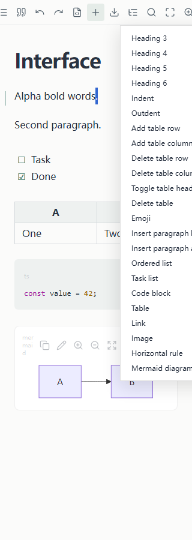
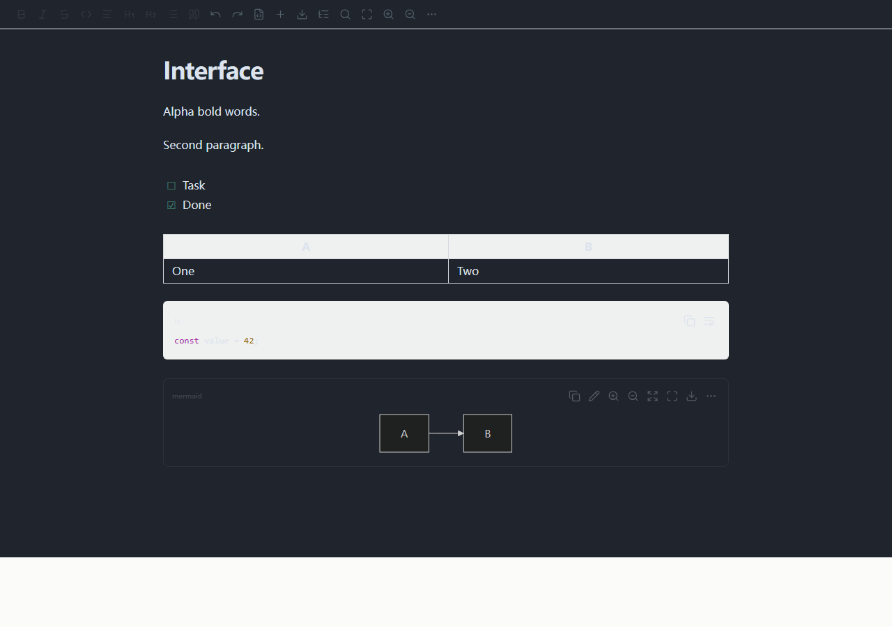

# UI 布局、全部按钮与快捷键审查

本轮记录 **158 次操作、去重后 141 个操作场景**，覆盖 20 个一级工具栏按钮、23 个 Insert 项、10 个 More 项，以及代码/图表工具、弹窗提交/取消、PDF 和冲突操作。额外有真实 VS Code 宿主中的 OS 剪贴板、下载、快捷键、右键菜单和主题验证。

“点击执行成功”不等于“体验合格”：还检查无目标/普通段落/表格等上下文、名称是否符合行为、是否保留选区、是否值得占据一级空间。原始记录中的无异常指测试脚本未抛错，绝不等于所有产品行为正常。

## 布局判断

1. 工具栏有 20 个相似的小图标，缺少样式/插入/阅读/导出的视觉分组。低频导出、来源、两个字号按钮与高频格式操作竞争空间。建议一级保留样式下拉、粗体/斜体/行内代码、列表组、撤销/重做、插入、导航，其他动作放上下文或 More。具体固定哪些可由 10 名目标用户任务频次验证，不靠个人审美定论。
2. 实测工具栏内容最小宽度约 650 px；600 px 已溢出，320 px 需要横向滚动。点 Insert 时浏览器可能自动横移工具栏，导致刚才的按钮消失。Insert 菜单却固定在 x=200、宽 180，320 px 窗口右侧超出 60 px。应相对触发器定位并避让边界，按优先级折叠。
3. 查找导航固定宽 270 px，400 px 窗口遮挡 67.5% 正文；没有明显关闭入口，Esc 不工作。应支持可关闭覆盖层或上下布局，正文保持可读。
4. 普通状态隐藏在 1×1 px 的 sr-only 元素；来源仅通过 URI tooltip 提示。缺少当前文件、未保存清单与模式反馈。应保留屏幕阅读器语义，同时让普通用户看见必要状态。
5. 手动 dark 主题不完整：表头与代码普通文字近白对白；原生 VS Code 深色样例较好，高对比主题仍有硬编码语法色。应默认继承宿主主题。
6. 插入动作使用长期悬浮菜单，阅读设置却使用模态 dialog；两者关闭与焦点规则不一致。Info/Help 被当作 warning 显示，无法自然收起；不应让用户每次设置阅读宽度都被模态打断。

## 一级工具栏：20 项逐项结论

| 按钮 | 实测行为/问题 | 是否必要、放在哪里 | 快捷键现状 | 验收重点 |
| --- | --- | --- | --- | --- |
| Bold | 选区鼠标加粗有效；初次无编辑目标仍可点 | 保留常用入口 | Ctrl+B 有提示；选区/焦点需按真实宿主回归 | 有目标则切换；无目标禁用；选区和焦点不丢 |
| Italic | 选区鼠标斜体有效 | 保留常用入口 | Ctrl+I 有提示 | 同上 |
| Strikethrough | 选区删除线有效 | 移入次级格式菜单 | 无专门快捷键 | 不占紧凑工具栏；菜单里可找到 |
| Code | 鼠标行内代码有效 | 保留 | 已绑定 Ctrl+反引号，但 tooltip 未说明 | 提示和实际绑定一致，避免误认为块代码 |
| Paragraph | 可转为普通段落；图标不直观 | 与标题合并成样式下拉 | 未绑定 | 下拉显示当前段落样式 |
| Heading 1 | 转换有效；没有当前标题状态 | 合并进样式下拉 | 未绑定 | 切换保留选区，状态与正文一致 |
| Heading 2 | 同上 | 合并进样式下拉 | 未绑定 | 同上 |
| List | 首次加列表有效；再次点击不取消 | 保留并修成可理解的切换 | Tab/Shift+Tab 仅在列表上下文缩进 | 列表/非列表状态明确；重复点击符合约定 |
| Quote | 首次引用有效；再次点击变成嵌套引用 | 保留或移到格式菜单 | 未绑定 | 取消引用与增加层级分开，不能让同一图标含义漂移 |
| Undo | 发送原生 undo；无历史也常亮；一次输入通常只撤一字符 | 保留 | Ctrl+Z 有提示，但弹窗中错误抢占 | 无历史禁用；弹窗内撤销只改该输入框 |
| Redo | 发送 redo；无历史也常亮 | 保留 | Ctrl+Shift+Z / Ctrl+Y；只提示前者 | 无历史禁用；菜单说明两个支持组合 |
| Reveal source | 活动块发送正确来源；未激活时无反应 | 保留为来源菜单/右键；减少重复 | 未绑定；命令面板没有该命令 | 无目标禁用；快捷入口能定位到原文件和段落 |
| Insert | 打开 23 项混合菜单；Esc/外部点击不关闭 | 必须保留，但重组 | 未绑定 | 菜单能关闭、键盘进入；只展示适用操作 |
| Export PDF | 能打开参数弹窗；错误参数下取消受阻 | 保留在导出/更多；技术文档高频者可固定 | 命令面板有命令，无默认快捷键 | 预览、导出、取消完整闭环；可自定义绑定 |
| Outline | 显示 ATX 标题；漏 Setext，流式追加时不完整 | 保留长文导航 | 未绑定 | 完整标题树、当前章高亮、加载中提示 |
| Find | 打开搜索；缺命中高亮和关闭流程 | 保留 | Ctrl+F 有提示 | Enter/Shift+Enter/Esc、结果计数及定位全部正常 |
| Fullscreen | 真实编辑区 794×752 前后不变，只改 focus-mode | 重命名为专注模式，或实现真全屏 | 未绑定；不要冒用 F11 含义 | 按钮名字与行为一致，退出入口明确 |
| Zoom in | 正文字号 +1，范围 12–28 px | 移到阅读设置，与 Zoom out 合并 | 未绑定 | 有字号值/重置；不改变文件内容 |
| Zoom out | 正文字号 -1 | 同上 | 未绑定 | 同上 |
| More | 用模态弹窗承载轻量设置；存在重复来源入口 | 保留但改清晰的轻量菜单 | 未绑定 | 显示当前状态，Esc 关闭并恢复原焦点 |

## Insert：23 项逐项结论

| 按钮 | 实测行为 | 必要性/位置 | 操作与快捷键要求 |
| --- | --- | --- | --- |
| Heading 3 | 可转 H3 | 必要；与 H1/H2/Paragraph 合并进样式选择 | 无专门快捷键；当前 H1/H2 与 H3–H6 入口割裂 |
| Heading 4 | 可转 H4 | 必要；与 H1/H2/Paragraph 合并进样式选择 | 无专门快捷键；当前 H1/H2 与 H3–H6 入口割裂 |
| Heading 5 | 可转 H5 | 必要；与 H1/H2/Paragraph 合并进样式选择 | 无专门快捷键；当前 H1/H2 与 H3–H6 入口割裂 |
| Heading 6 | 可转 H6 | 必要；与 H1/H2/Paragraph 合并进样式选择 | 无专门快捷键；当前 H1/H2 与 H3–H6 入口割裂 |
| Indent | 列表项内有意义，普通段落点后无变化 | 必要；放列表上下文菜单 | Tab；不适用时应禁用 |
| Outdent | 同上 | 同上 | Shift+Tab；不适用时应禁用 |
| Add table row | 表格内有效，普通段落无效仍可点 | 必要；移到表格工具 | 无专门绑定 |
| Add table column | 同上 | 同上 | 无专门绑定 |
| Delete table row | 同上 | 同上；应支持撤销 | 无专门绑定 |
| Delete table column | 同上 | 同上；应支持撤销 | 无专门绑定 |
| Toggle table header | 表格内有效；文外无反馈 | 表格上下文中必要 | 显示当前表头状态 |
| Delete table | 表格内有效；文外无反馈 | 表格上下文中必要 | 确保能撤销，不能混在普通插入操作中 |
| Emoji | 只插入固定 😀 | 低必要性，移除或改成真正选择器 | 无需默认快捷键 |
| Insert paragraph before | 添加当前块前的空段落，未输入时 Markdown 可能不变化 | 保留在块上下文中 | 插入后应把光标移到新段落 |
| Insert paragraph after | 同上，添加到块后 | 同上 | 同上 |
| Ordered list | 可插入有序列表 | 必要；与无序/任务列表成组 | 应有上下文状态 |
| Task list | 插入固定 Task 占位；可修改 | 技术文档有用 | 插入后选中占位文本；复选框需键盘语义 |
| Code block | 能转为代码块；没有语言选择 | 核心必要 | 补语言选择；Ctrl+Enter 退出的提示缺失 |
| Table | 默认 2×2；增加行测试后为 3 行 | 必要 | 插入后定位首格；提供规模选择 |
| Link | 插入/取消/Esc 均能工作；弹窗 Ctrl+Z 会撤正文 | 必要 | 不要直接占用 VS Code 常用的 Ctrl+K 前缀；注册可配置命令 |
| Image | 能写图片节点；必须手填路径和替代文字 | 必要但流程不足 | 补文件选择/粘贴截图，路径按子文件归属解析 |
| Horizontal rule | 能替换选区为分隔线 | 次级菜单中保留 | 无需默认快捷键 |
| Mermaid diagram | 插入默认示例图；可继续编辑 | 技术文档核心能力 | 替换选区的后果要明确；插入后进入可编辑代码/预览 |

## More：10 项逐项结论

| 按钮 | 实测行为 | 必要性/位置 | 改进要求 |
| --- | --- | --- | --- |
| Reading width | 能切换宽/窄；未展示当前选项 | 保留阅读设置 | 应显示单选状态并持久化 |
| Read-only preview | 普通正文不激活；Mermaid 仍能修改 | 必要，但现有约束不完整 | 统一约束所有修改入口，模式可见 |
| WYSIWYG editing | 能恢复正文可编辑 | 与只读合并成模式切换 | 不要同时显示两个没有当前状态的动作 |
| Edit block source | 能显示 textarea；弹窗关闭后焦点可能落到 BODY | 高级用户需要 | 打开后聚焦文本；无活动块时禁用 |
| Code theme | 切换 contrast-code 样式 | 保留到设置中 | 需有名称/预览，适配所有主题 |
| Light / dark theme | 手动 dark 导致表头/代码普通文字近白对白 | 建议默认跟随 VS Code；手动覆盖为次级设置 | 若保留必须覆盖全部前景/背景，不能只换 body |
| About | 将版本信息显示在警告条 | 低频入口可保留 | 使用普通信息弹窗，不要伪装成警告且无法关闭 |
| Reveal source | 与工具栏重复 | 合并来源上下文入口 | 右键实际没有它，但 Help 声称有 |
| Help | 显示含 ? 分隔符的简短文案；与实际右键菜单不符 | 有必要，内容应补全 | 一页可查快捷键与限制，文案必须可执行 |
| Close | 关闭当前设置弹窗 | 作为临时模态界面可用 | 若改成菜单则用 Esc/外部点击关闭，不必专门 Close |

## 代码、图表、弹窗、导出与冲突

| 按钮 | 实测行为 | 是否必要 | 量化/可操作验收 |
| --- | --- | --- | --- |
| 代码/Copy | 有焦点复制成功；无焦点 NotAllowedError，界面无反馈 | 必要，需修复 | 20 次各焦点状态，OS 剪贴板 100% 正确，1 s 内反馈 |
| 代码/Wrap lines | 能切换白空格布局，不改源码 | 必要但非每人高频 | 状态可见、可持久化；不撑破编辑区 |
| 图表/Copy | 复制 Mermaid 源码，不是图片，图标未说明 | 必要但重命名 Copy source | 源代码与复制结果一致，错误有反馈 |
| 图表/Edit | 可打开代码编辑弹窗 | 必要 | 弹窗有标题，预览/错误可理解，焦点正确 |
| 图表/Zoom in | 修改 SVG 宽度，能放大 | 必要 | 只影响当前图，显示比例，支持键盘 |
| 图表/Zoom out | 能缩小 | 必要 | 有最小值，比例不丢 |
| 图表/Fit diagram | 将宽度恢复到 100%，更像重置缩放 | 必要但命名要准确 | 若叫 Fit，应实际按容器与图尺寸适配 |
| 图表/Fullscreen | 打开图表弹窗，和工具栏同名动作不同 | 必要，改名放大查看 | 默认适配空间，Close/Esc 能退出 |
| 图表/Export SVG | 真实 VS Code 中触发 diagram.svg 下载 | 保留在图表导出菜单 | 20 个样例下载有效 SVG，文件名可区分 |
| 图表/Export PNG | 无下载；已定位 canvas tainted SecurityError | 保留但必须修复 | 20 个含文字/中文/foreignObject 的样例全成功，异常有反馈 |
| 图表编辑/Apply | 写回新代码；只读仍会写入 | 必要，统一模式检查 | 成功后同步所有引用；只读修改事件为 0 |
| 图表编辑/Cancel | 修改后取消不改源内容 | 必要 | Ctrl+Z 留在代码框；取消/Esc 清理资源和隐藏 dialog |
| 图表放大/Close | 关闭并移除图表弹窗 | 必要 | 返回原图按钮焦点，不改变滚动位置 |
| 链接弹窗/Insert | 有效输入能生成 Markdown 链接 | 必要 | 标签清楚、错误保留输入；20 个转义样例通过 |
| 链接弹窗/Cancel | 不改正文并关闭 | 必要 | 键盘和鼠标一致 |
| 图片弹窗/Insert | 能生成图片 Markdown | 必要 | 检查路径/资源归属，用户知道图片放在哪里 |
| 图片弹窗/Cancel | 不改正文并关闭 | 必要 | 同上 |
| PDF/Preview | 发送 preview:true，现有宿主套件生成了有效 PDF | 必要 | 预览包含未保存内容，不偷偷保存源 Markdown |
| PDF/Export | 发送 preview:false；真实生成/失败路径由宿主套件覆盖 | 必要 | 成功才覆盖目标；完成可打开，失败保留原文件 |
| PDF/Cancel | 正常参数可取消；margin=100 时 Cancel 被校验阻止 | 必须修复 | 合法/非法/空数值各 20 次，取消总能退出且不产生导出 |
| 冲突/Reload external version | 按钮发送正确 reload 消息；模型已有冲突测试 | 核心必要；应提示会丢弃本地版本 | 执行前可查看差异/复制本地稿；测试不静默丢内容 |
| 冲突/Keep editor version | 按钮发送 keep 消息 | 核心必要；应明确后续会覆盖哪个文件 | 再次检查磁盘版本，不能把旧选择套到新外部版本 |
| 冲突/View diff | 按钮发送 diff 消息，宿主提供差异视图 | 核心必要 | 差异两边标题和来源清晰，返回后草稿仍在 |

冲突三按钮在浏览器适配器中验证消息和选择；没有在本轮真实宿主中分别点击三种冲突后把完整多文件生命周期全部跑一遍。模型冲突路径、真实宿主保存/备份路径有已有套件支持；这里明确区分覆盖层级，不能把前端消息正确宣称为完整端到端通过。

## 快捷键：有绑定还要能发现、能在正确上下文工作

| 动作 | 当前实现/实测 | 判断与建议 |
| --- | --- | --- |
| 保存 | Ctrl+S 有全局拦截；按预期保存 | 保留；Tooltip/Help 说明；保存结果可见 |
| 另存为 | Ctrl+Shift+S 在页面被同一个 s 分支截成 save；真实测试写回原文件，没有 Save As 对话框 | P0：按修饰键区分，或交由原生 Save As；跨目录限制应提前说明 |
| 撤销/重做 | Ctrl+Z / Ctrl+Shift+Z / Ctrl+Y 有效，但链接弹窗内 Ctrl+Z 会撤掉正文最后一个字符，输入框内容不变 | P0：按事件目标隔离输入框/textarea/contenteditable 的原生历史；不要全页面抢占 |
| 粗体/斜体 | Ctrl+B / Ctrl+I 存在绑定与 tooltip；等待选区稳定的浏览器样例可工作；快速自动序列在宿主中存在选区/焦点不一致 | 不能笼统称全部失效或全部正常；加真实宿主中 20 个稳定选区与快速选区回归 |
| 行内代码 | Ctrl+反引号有绑定，tooltip 未显示；宿主可对后续输入应用 code mark | 补提示和命令；回归与 VS Code 原生快捷键的上下文交互 |
| 查找 | Ctrl+F 可打开；Esc/结果遍历不完整 | 补 Enter/Shift+Enter/Esc；不要只验收“打开一个输入框” |
| 列表缩进 | Tab/Shift+Tab 作用于表格导航/列表缩进；代码中 Tab 移出编辑块 | 按当前节点类型处理，代码缩进与表格导航要分开 |
| 退出代码块 | Ctrl+Enter 有内部绑定，无可发现提示 | 在代码块帮助/菜单中展示 |
| 标题、链接、来源、图表、插入、导出 | 除导出/打开两个宿主命令外，大部分没有可配置命令入口；只绑 DOM 事件，用户不能在 VS Code Keyboard Shortcuts 中正常改绑 | 注册有上下文 when 条件的命令。先检查宿主冲突，再选择默认组合；无需给所有低频按钮强加快捷键 |
| 菜单键盘 | Insert 没有完整 menu/expanded 状态、方向键与 Esc 流程 | 参考菜单按钮模式，焦点进入项目、Esc 回触发器、关闭状态准确 |

VS Code 官方要求 Webview 适配主题、键盘及辅助功能，并提供命令动作；这些要求用于本次审查，不等于已做完整无障碍认证。参考 [VS Code Webview UX](https://code.visualstudio.com/api/ux-guidelines/webviews)。菜单的焦点与展开语义参考 [W3C Menu Button Pattern](https://www.w3.org/WAI/ARIA/apg/patterns/menu-button/)。

## UI 的统一验收门槛

| 方面 | 条件 |
| --- | --- |
| 逐按钮状态 | 本报告所有控件在无活动块/正文/表格/代码/只读状态均有定义；不适用动作禁用或不展示，不允许静默空操作 |
| 用户预期 | 10 名目标用户中 ≥9 人能正确预测主要按钮行为；不知道含义时 Tooltip 能明确说明对象、动作及快捷键 |
| 快捷键 | 所有声明的快捷键在真实 VS Code 各运行 20 次，无宿主冲突、无错误对象修改；自定义绑定可用 |
| 局部输入历史 | 链接、图片、PDF、Mermaid 与原文框中撤销/重做只修改当前输入；每种 20 次全部通过 |
| 菜单/弹窗 | 100 次打开/关闭/取消/Esc/外部点击，按预定义行为全部通过；隐藏 dialog 不累积，焦点返回触发点或编辑位置 |
| 自适应 | 320/400/600/900/1280 px、100%/200% 缩放，无弹出菜单越界和不可达主操作；普通正文不横向滚动 |
| 反馈 | 点击后的视觉反馈 ≤100 ms；复制/保存/导出最终结果明确，超过 1 s 的操作有进度，失败含可执行建议 |
| 模式与来源 | 当前编辑/只读、当前来源、未保存数量明确；只读全部修改入口产生 0 次内容变化 |
| 主题 | 浅/深/高对比的文字、焦点、禁用与 hover 均可分辨，普通文字对比度目标 ≥4.5:1 |
| 可用性任务 | 10 人中 ≥9 人无需源码完成修改子章节、格式化、插入图片/代码、查找、保存与确认来源；记录每步时间与误操作 |

原始数据：[audit.json](audit.json)，其中记录每次操作前后的源 Markdown、焦点、DOM、消息、语言样例；系统集成补测见 [supplement.json](../live/supplement.json)、[diagnostics.json](../live/diagnostics.json)。复跑：`node --import tsx docs/review-artifacts/interaction-audit.ts`，补测：同命令加 `--extras`。

## 长文档导航的真实宿主补测

5 MB 常见词产生 29810 个查找结果按钮，首次到更新帧约 1.35 s；改搜不存在的词时出现 12.107 s 主线程任务。大纲一次生成 29811 个按钮，约 1.05 s 才到两个帧，最长任务 915 ms。从 Find 点击 Outline 还会把面板切为隐藏。必须虚拟化结果、正确区分面板模式和开关状态。验收：3 万命中首批结果 ≤300 ms、关键词切换 P95 ≤300 ms、结果 DOM ≤100、无 >100 ms 主线程任务；20 次 Find↔Outline 切换不意外关闭面板。见 [并发与导航数据](../live/concurrent.json)。
